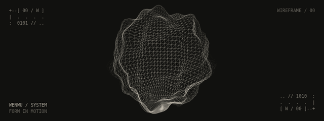
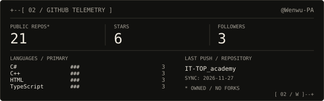

<!-- WENWU / 文武 -->

<div align="center">
  
</div>

# Wenwu / 文武

`ARTEMII POLIKARPOV` · `JUNIOR BACKEND DEVELOPER`

Building reliable services, practical tools and systems that make sense.

```text
+--[ STACK / 01 ]
|  Backend   :: Python / FastAPI / Django / Node.js / TypeScript
|  Systems   :: Linux / Docker / Git / CI/CD / OpenWrt
|  Data      :: MySQL / REST API
+--[ LESS, BUT BETTER ]
```

[Resume](resume.pdf) · [Documentation](https://wenwu-pa.github.io/wenwu-docs/) · [Email](mailto:artemiip427@gmail.com)

<picture>
  <source media="(prefers-color-scheme: light)" srcset="assets/github-light.svg">
  
</picture>
